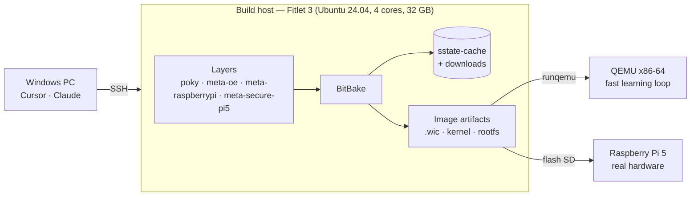

# yocto-secure-pi5

A 10-day, hands-on project to learn **Yocto**, the **Linux boot process and filesystem**, and **embedded device hardening** by building a custom, security-focused Linux distribution for the **Raspberry Pi 5** — the same workflow used to ship industrial IoT gateways.

> Goal: understand every layer between "power on" and "login prompt", and be able to explain *why* each security control exists — not just copy commands.

## How the pieces fit



```
Power on (Pi 5)
 └─ EEPROM bootloader ─► config.txt / firmware ─► (U-Boot) ─► Linux kernel + DTB
     └─ kernel mounts rootfs ─► init (systemd / sysvinit) ─► services ─► login
```
Each arrow is a place where trust can be **verified** (signed, measured, read-only) or **broken**. Days 5–9 walk that chain.

## Stack

| Piece | Choice | Why |
|---|---|---|
| Yocto release | **5.0 Scarthgap (LTS)** | Proven Pi 5 support; see [ADR-0001](docs/decisions/0001-yocto-release.md) |
| Build host | Fitlet 3, Ubuntu 24.04 LTS | Supported host distro for Scarthgap and Wrynose |
| Targets | `qemux86-64` → `raspberrypi5` | Learn in QEMU first, then real hardware |
| Custom layer | `meta-secure-pi5` (created Day 3) | Where all my changes live — never edit upstream layers |

## Repo layout

```
.
├── CLAUDE.md                 # context for Claude Code
├── .cursor/rules/            # context for Cursor
├── conf-snippets/            # local.conf settings to copy in, with explanations
├── docs/
│   ├── PLAN.md               # the 10-day plan
│   ├── architecture.md       # boot chain + trust chain diagrams
│   ├── decisions/            # ADRs (why I chose X)
│   └── journal/              # one entry per day
├── scripts/
│   ├── setup-host.sh         # host packages for Ubuntu 24.04
│   └── fetch-layers.sh       # clone pinned layers into layers/
├── layers/                   # (gitignored) upstream layers
├── meta-secure-pi5/          # (Day 3) my layer — committed
└── build/                    # (gitignored) BitBake build dir
```

## Quick start (on the Fitlet)

```bash
git clone git@github.com:PetrickMac/yocto-secure-pi5.git ~/yocto-secure-pi5
cd ~/yocto-secure-pi5
./scripts/setup-host.sh          # once
./scripts/fetch-layers.sh        # clones layers + writes layers.lock
tmux new -s yocto
source layers/poky/oe-init-build-env build
bitbake core-image-minimal       # first build: hours on 4 cores
runqemu qemux86-64 nographic     # Ctrl+a x to quit
```

## Progress

See [docs/PLAN.md](docs/PLAN.md) and [docs/journal/](docs/journal/).
