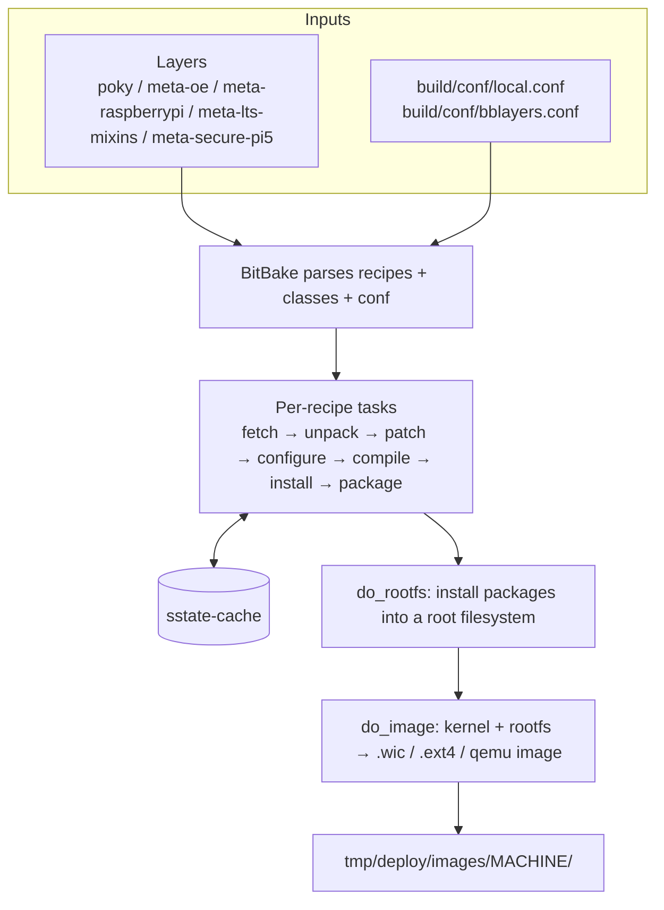

# Architecture

> Living document — update with what I *observe*, not just what docs say.

## 1. Build pipeline (on the Fitlet)



## 2. Boot chain — Raspberry Pi 5 (fill in on Day 5)

```
 Stage                 Lives where              Who verifies the next stage?      Observed?
 ─────────────────────────────────────────────────────────────────────────────────────────
 1. Boot ROM           SoC (immutable)          (secure boot: checks EEPROM sig)  [ ]
 2. EEPROM bootloader  SPI EEPROM on board      (secure boot: checks boot.img)    [ ]
 3. Firmware + config  boot partition (FAT)     nothing by default                [ ]
    config.txt, cmdline.txt, DTB, overlays
 4. U-Boot (optional)  boot partition           FIT signature check (Day 9)       [ ]
 5. Linux kernel       boot partition           dm-verity on rootfs (concept)     [ ]
 6. Root filesystem    ext4 partition           —                                 [ ]
 7. init (PID 1)       /sbin/init → systemd     —                                 [ ]
```

## 3. Trust chain (fill in on Day 9)

| Stage | Default (my image) | Production hardening | Reversible to try? |
|---|---|---|---|
| EEPROM | unsigned | Pi 5 secure boot, key hash in OTP | **No — OTP is permanent** |
| Kernel | unsigned | U-Boot signed FIT | Yes |
| Rootfs | writable ext4 | read-only + dm-verity | Yes |
| Userspace | debug-tweaks | no root login, SSH keys, minimal packages | Yes |
| Updates | reflash SD | A/B (RAUC / Mender / ADU) | Yes |
